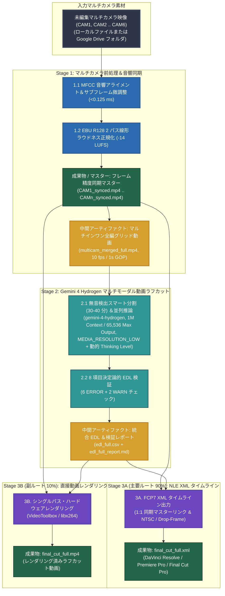

# Multi-Camera Video Pipeline & AI Editing Suite

[](https://github.com/googleapis/python-genai)
[](https://cloud.google.com/vertex-ai)
[](https://ffmpeg.org/)

[English (en)](README.md) | [繁體中文 (zh-TW)](README.zh-TW.md) | [简体中文 (zh-CN)](README.zh-CN.md) | [日本語 (ja)](README.ja.md) | [한국어 (ko)](README.ko.md)

---

> [!IMPORTANT]
> **Google Antigravity ネイティブプラグイン＆ワークフロースイート**  
> 本ツールキットは、**Google Antigravity**（**Vertex AI Gemini 4 Hydrogen**, `gemini-4-hydrogen` 搭載）およびプロ向け NLE（**DaVinci Resolve**、**Adobe Premiere Pro**、**Final Cut Pro**）向けの 3 ステージ・マルチカメラ前処理＆AI ラフカットワークフローを提供します。

---

**Multi-Camera Video Pipeline & AI Editing Suite** は、2〜6 台のカメラ映像の音響同期、ラウドネス正規化、AI ラフカットタイムライン生成、およびマルチカメラプレビュー動画レンダリングを実行します。Antigravity チャット画面で自然言語で指示すると、マルチカメラ前処理からラフカット生成までを自動実行します。

---

## インストールと Google Cloud セットアップ (`setup.sh`)

本プロジェクトは [Agent Plugins 1.0](https://agent-plugins.org/) に準拠し、**Google Cloud Vertex AI (ADC)** と **Cloud Storage (GCS)** 上で動作します（API キー管理不要）。

### ステップ 1 — Antigravity Plugin のインストール

```bash
agy plugin install https://github.com/sylphlin/multicam-video-preprocessing
```

### ステップ 2 — Python およびメディア依存関係のインストール

`requirements.txt` をインストールします。システムに FFmpeg がない場合、`static-ffmpeg` がクロスプラットフォームの `ffmpeg` と `ffprobe` バイナリを自動提供します。ネイティブの FFmpeg がインストール済みの場合は、既存の FFmpeg とハードウェアアクセラレーション（`h264_videotoolbox`）を優先保持します。

```bash
pip install -r ~/.gemini/config/plugins/multicam-video-preprocessing/requirements.txt
```

### ステップ 3 — ADC 認証と Google Cloud リソースの構成 (`setup.sh`)

Application Default Credentials を認証し、`setup.sh` を実行して GCS バケット、2 階層ライフサイクルルール（`raw/`: 2 日、成果物: 15 日）、IAM 権限、および `.env` を構成します：

```bash
gcloud auth application-default login
cd ~/.gemini/config/plugins/multicam-video-preprocessing
chmod +x setup.sh
./setup.sh --project YOUR_GCP_PROJECT_ID
```

### ディレクトリ構造（Agent Plugins 1.0 準拠）
```text
multicam-video-preprocessing/
├── plugin.json                                           # Antigravity プラグインマニフェスト
├── assets/
│   └── logo.svg                                          # プラグインベクターアイコン
├── requirements.txt                                      # Python およびクロスプラットフォーム static-ffmpeg 依存関係
├── rules/
│   └── AGENTS.md                                         # 同梱クライアント実行ルール（<PLUGIN_ROOT> 直接 CLI 実行・Fail-Fast）
├── .agents/
│   └── rules/
│       └── DEVELOPMENT.md                                # ワークスペース＆開発規約（Part I & Part II）
├── skills/
│   └── multicam-video-preprocessing/                     # 標準スキルバンドル（Single Source of Truth）
│       ├── SKILL.md                                      # スキル仕様および 3 ステージ実行ランブック
│       ├── scripts/                                      # コア実行スクリプト＆モジュール (SSOT)
│       │   ├── multicam_pipeline.py                      # Stage 1: MFCC 同期、-14 LUFS 正規化、同期マスター、グリッド合成
│       │   ├── generate_edl.py                           # Stage 2: Vertex AI Gemini 4 Hydrogen EDL 生成＆無音スマート分割
│       │   ├── export_fcp7_xml.py                        # Stage 3A: FCP7 XML タイムライン出力（主要ルート）
│       │   ├── edl_to_video.py                           # Stage 3B: シングルパス・ハードウェア動画レンダリング（副ルート）
│       │   └── modules/                                  # 音響、動画、無音分割、検証、GCP/Vertex AI モジュール
│       └── assets/                                       # プロンプトテンプレート (SSOT)
│           └── edl_interview_template.md                 # Gemini マルチモーダル・インタビューラフカット規則
├── setup.sh                                              # ネイティブ gcloud セットアップスクリプト（GCS、ライフサイクル、IAM、.env）
├── .env.example                                          # Vertex AI (ADC) および GCS 環境変数テンプレート
└── tests/                                                # オフライン単体テストスイート (54 テスト)
```

---

## 3 ステージ実行ワークフローアーキテクチャ



---

## Antigravity の操作方法と利用シナリオ (Usage & Scenarios)

Antigravity では以下の 2 つの方法で実行します：
1. **ショートカット指定（`/skill` + `@ファイル`）**：`/multicam-video-preprocessing` を選択し、`@` でカメラ映像や Google Drive フォルダを指定します。
2. **自然言語プロンプト**：同期や編集の要件を自然言語で記述し、`@` ファイルやクラウドリンクを添付します。

### シナリオ 1：NLE 用 FCP7 XML タイムライン出力（推奨メインワークフロー）
- **ユースケース**：AI ラフカットのカメラ切り替え判定を DaVinci Resolve、Adobe Premiere Pro、または Final Cut Pro に読み込み、本編集やカラーグレーディングを行います。
- **方法 A（`/ + @` ショートカット指定）**：
  ```text
  /multicam-video-preprocessing CAM1: @CAM1.mp4, CAM2: @CAM2.mp4
  ```
- **方法 B（自然言語プロンプト）**：
  ```text
  @CAM1.mp4 と @CAM2.mp4 を同期してラウドネスを -14 LUFS に正規化し、DaVinci Resolve 用の FCP7 XML ラフカットタイムラインを出力して。
  ```
- **生成される成果物**：
  1. `final_cut_full.xml`（カメラ切り替え点と理由マーカーを含むタイムライン）。
  2. `CAM1_synced.mp4`、`CAM2_synced.mp4`（時間同期および `-14 LUFS` 正規化済みカメラマスター）。
- **DaVinci Resolve への読み込み手順**：
  1. DaVinci Resolve を開き、新規プロジェクトを作成します。
  2. `output/CAM1_synced.mp4` と `output/CAM2_synced.mp4` を **Media Pool** にドラッグします。
  3. **File -> Import -> Timeline...**（`Cmd + Shift + I`）を選択し、`final_cut_full.xml` を読み込みます。

### シナリオ 2：ラフカット動画の直接レンダリング
- **ユースケース**：NLE を開かずに、カメラ切り替え済みの MP4 ラフカット動画を直接レンダリングします。
- **方法 A（`/ + @` ショートカット指定）**：
  ```text
  /multicam-video-preprocessing CAM1: @CAM1.mp4, CAM2: @CAM2.mp4, 出力: MP4 直接レンダリング
  ```
- **方法 B（自然言語プロンプト）**：
  ```text
  @CAM1.mp4 と @CAM2.mp4 をマルチカメラ AI ラフカットして、final_cut_full.mp4 を直接レンダリングして。
  ```
- **生成される成果物**：
  1. `final_cut_full.mp4`（シングルパス・ハードウェアレンダリング済み動画）。
  2. `edl_full.csv` および `edl_full_report.md`（カメラ切り替えリストと 8 項目検証レポート）。

### シナリオ 3：Google Drive フォルダからのマルチカメラ同期＆ラフカット
- **ユースケース**：Google Drive 共有フォルダ内の全カメラ映像を `md5Checksum` キャッシュ検証付きで取得し、同期からタイムライン出力までを実行します。
- **方法 A（`/ + @` ショートカット指定）**：
  ```text
  /multicam-video-preprocessing フォルダ: https://drive.google.com/drive/folders/FOLDER_ID
  ```
- **方法 B（自然言語プロンプト）**：
  ```text
  Google Drive フォルダ https://drive.google.com/drive/folders/FOLDER_ID のマルチカメラ素材を同期・正規化して、FCP7 XML タイムラインを生成して。
  ```
- **生成される成果物**：
  1. `CAM1_synced.mp4` .. `CAMn_synced.mp4`（同期・ラウドネス正規化済みマスター）。
  2. `edl_full.csv`、`edl_full_report.md`、`final_cut_full.xml`。

---

## 3 ステージ技術概要

### Stage 1：マルチカメラ同期＆前処理
1. **MFCC 音響アライメント＆サブフレーム微調整（`<0.125 ms`）**：3 段階フォールバック（120 秒高速スキャン $\rightarrow$ 全編 MFCC $\rightarrow$ 生波形 1D FFT）を実行し、`8 kHz` の 1 サンプル精度にロックしつつ FFT メモリ使用量を `97.7%` 削減します。
2. **EBU R128 (`-14 LUFS`) 2 パス線形ラウドネス正規化**：パス 1 で `I`、`LRA = 11.0 LU`、`TP = -1.5 dBTP` を計測し、パス 2 で線形ゲイン（`linear=true`）を適用します。
3. **フレーム精度同期マスター出力 (`CAM*_synced.mp4`)**：ハードウェアアクセラレーション（`h264_videotoolbox` または `libx264`、`20 Mbps`）で再エンコードし、キーフレームずれを防止します。
4. **全編コンパクトグリッド合成 (`multicam_merged_full.mp4`)**：2〜6 台の同期カメラを 1 枚のラベル付きキャンバス（$\le 1920 \times 1080$、各セル $\ge 640 \times 480$）に `10 fps`、`1.2 Mbps`、1 秒短 GOP で合成します。

### Stage 2：Gemini 4 Hydrogen マルチモーダルラフカット＆無音検出スマート分割
1. **プリロールおよびカウントダウン除去**：カチンコ、マイクテスト、開始前カウントダウン（`5, 4, 3, 2, 1`）を除去し、`[Global_Start_Time, Global_Start_Time + 2.0s]` を検証して終了後の雑談を `Global_End_Time` でトリミングします。
2. **Gemini 4 Hydrogen 標準マルチモーダル推論**：
   - デフォルトモデル `gemini-4-hydrogen`（**Vertex AI Gemini 4 Hydrogen**）を使用し、統合 `1M` トークンコンテキストウィンドウと思考・出力トークン共通の `65,536` `max_output_tokens` 上限を適用します。
   - 標準マルチモーダルモード（`MEDIA_RESOLUTION_LOW`）を実行し、`resolve_thinking_level` で動画長に応じた動的 `thinking_level`（`low` / `medium` / `high`）を設定します。Gemini 4 互換性のため `temperature` は省略します。
3. **無音検出スマート分割（`30〜40 分` ウィンドウ）**：
   - 40 分（`2400s`）以下の動画は 1 パスで処理します。
   - 40 分を超える動画では、`generate_edl.py` が `ffmpeg silencedetect` と RMS エネルギー極小値で自然な発話休止点を検出し、`<output_dir>/_edl_chunks/` に一時分割します。
   - `gs://<bucket>/raw/edl_chunks/` 経由で並列 Vertex AI 推論を実行し、タイムスタンプをシフトして `edl_full.csv` に統合した後、`finally` ブロックでローカルおよび GCS の一時チャンクを削除します。
4. **8 項目の決定論的 EDL 検証**：`E_NO_ROWS`、`E_PARSE_TIME`、`E_NEGATIVE_DURATION`、`E_NON_MONOTONIC`、`E_OVERLAP`、`E_EMPTY_CAMERA`、`W_UNKNOWN_CAMERA`、`W_GAP` を検証し、`edl_full.csv` と `edl_full_report.md` を出力します。

### Stage 3A & 3B：FCP7 XML タイムライン出力＆ハードウェア動画レンダリング
- **Stage 3A（主要ルート）**：同期マスターを 1:1 タイムコード（`start == in`, `end == out`）でリンクし、NTSC 非整数フレームレート（`23.976`, `29.97`, `59.94`）およびドロップフレームに対応した `final_cut_full.xml` を出力します。
- **Stage 3B（副ルート）**：ユーザーの指示に応じて同期マスターからシングルパス・ハードウェアレンダリングを実行し、`final_cut_full.mp4` を出力します。

---

## GCS 2 階層ライフサイクルポリシー (`gs://multicam-video-${PROJECT_ID}`)

| GCS パス接頭辞 (`matchesPrefix`) | 保存対象 | 保持期間 (`age`) | クリーンアップ動作 |
| :--- | :--- | :--- | :--- |
| **`raw/`** | 一時グリッド動画 (`multicam_merged_full.mp4`) ＆チャンク (`raw/edl_chunks/*`) | **2 日間 (`age: 2`)** | `raw/edl_chunks/*` は推論完了直後に `finally` で即時削除。全編動画は SHA-256 キャッシュ再利用のため 2 日間保持後に自動削除します。 |
| **`output/`**、**`deliverables/`**、**`multicam_assets/`** | XML/CSV タイムライン、レンダリング動画、検証レポート | **15 日間 (`age: 15`)** | チーム確認用に 15 日間保持した後、自動削除します。 |

---

## ライセンス (License)

本プロジェクトは [MIT License](LICENSE) を採用しています。
