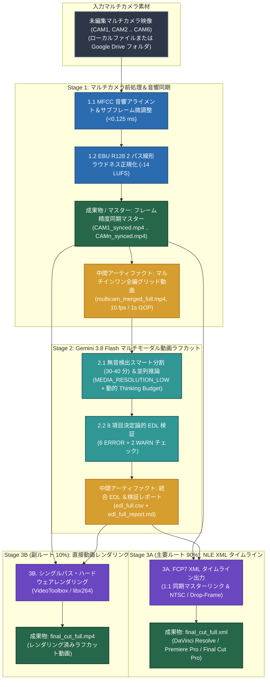

# Multi-Camera Video Pipeline & AI Editing Suite

[English (en)](README.md) | [繁體中文 (zh-TW)](README.zh-TW.md) | [简体中文 (zh-CN)](README.zh-CN.md) | [日本語 (ja)](README.ja.md) | [한국어 (ko)](README.ko.md)

---

> [!IMPORTANT]
> **Google Antigravity ネイティブプラグイン＆ワークフロースイート**  
> 本ツールキットは、**Google Antigravity**（**Vertex AI Gemini 3.8 Flash** 搭載）およびプロ向け NLE（**DaVinci Resolve**、**Adobe Premiere Pro**、**Final Cut Pro**）向けの 3 ステージ・マルチカメラ前処理＆AI ラフカットスイートです。

---

**Multi-Camera Video Pipeline & AI Editing Suite** は、2〜6 台のカメラ映像の音響同期、ラウドネス正規化、AI ラフカットタイムライン生成、およびマルチカメラプレビュー動画レンダリングを実行します。Antigravity チャット画面で自然言語で指示するだけで、マルチカメラ前処理からラフカット生成までを自動実行します。

---

## インストールと Google Cloud セットアップ (`setup.sh`)

本プロジェクトは [Agent Plugins 1.0](https://agent-plugins.org/) に準拠し、**Google Cloud Vertex AI (ADC)** と **Cloud Storage (GCS)** 上で動作します（API キー管理不要）。

### ステップ 1 — Antigravity Plugin のインストール

```bash
agy plugin install https://github.com/sylphlin/multicam-video-preprocessing
```

### ステップ 2 — Python およびメディア依存関係のインストール

`requirements.txt` をインストールします。システムに FFmpeg がない場合、`static-ffmpeg` がクロスプラットフォームの `ffmpeg` と `ffprobe` バイナリを自動提供します。ネイティブの FFmpeg がインストール済みの場合は、既存の FFmpeg とハードウェアアクセラレーション（`h264_videotoolbox`）を優先保持します。

```bash
pip install -r ~/.gemini/config/plugins/multicam-video-preprocessing/requirements.txt
```

### ステップ 3 — ADC 認証と Google Cloud リソースの構成 (`setup.sh`)

Application Default Credentials を認証し、`setup.sh` を実行して GCS バケット、2 階層ライフサイクルルール（`raw/`: 2 日、成果物: 15 日）、IAM 権限、および `.env` を構成します：

```bash
gcloud auth application-default login
cd ~/.gemini/config/plugins/multicam-video-preprocessing
chmod +x setup.sh
./setup.sh --project YOUR_GCP_PROJECT_ID
```

### ディレクトリ構造（Agent Plugins 1.0 準拠）
```text
multicam-video-preprocessing/
├── plugin.json                                           # Antigravity プラグインマニフェスト
├── assets/
│   └── logo.svg                                          # プラグインベクターアイコン
├── requirements.txt                                      # Python およびクロスプラットフォーム static-ffmpeg 依存関係
├── rules/
│   └── AGENTS.md                                         # 同梱クライアント実行ルール（<PLUGIN_ROOT> 直接 CLI 実行・Fail-Fast）
├── .agents/
│   └── rules/
│       └── DEVELOPMENT.md                                # ワークスペース＆開発規約（Part I & Part II）
├── skills/
│   └── multicam-video-preprocessing/                     # 標準スキルバンドル（Single Source of Truth）
│       ├── SKILL.md                                      # スキル仕様および 3 ステージ実行ランブック
│       ├── scripts/                                      # コア実行スクリプト＆モジュール (SSOT)
│       │   ├── multicam_pipeline.py                      # Stage 1: MFCC 同期、-14 LUFS 正規化、同期マスター、グリッド合成
│       │   ├── generate_edl.py                           # Stage 2: Vertex AI Gemini 3.8 Flash EDL 生成＆無音スマート分割
│       │   ├── export_fcp7_xml.py                        # Stage 3A: FCP7 XML タイムライン出力（主要ルート）
│       │   ├── edl_to_video.py                           # Stage 3B: シングルパス・ハードウェア動画レンダリング（副ルート）
│       │   └── modules/                                  # 音響、動画、無音分割、検証、GCP/Vertex AI モジュール
│       └── assets/                                       # プロンプトテンプレート (SSOT)
│           └── edl_interview_template.md                 # Gemini マルチモーダル・インタビューラフカット規則
├── setup.sh                                              # ネイティブ gcloud セットアップスクリプト（GCS、ライフサイクル、IAM、.env）
├── .env.example                                          # Vertex AI (ADC) および GCS 環境変数テンプレート
└── tests/                                                # オフライン単体テストスイート (50 テスト)
```

---

## 3 ステージ実行ワークフローアーキテクチャ



---

## Antigravity の操作方法と利用シナリオ (Usage & Scenarios)

Antigravity では以下の 2 つの方法で実行できます：
1. **ショートカット指定（`/skill` + `@ファイル`）**：`/multicam-video-preprocessing` を選択し、`@` でカメラ映像や Google Drive フォルダを指定するだけで実行できます。
2. **自然言語プロンプト**：通常の会話文で要望を伝え、`@` ファイルやクラウドリンクを添付すると自動的にプラグインが呼び出されます。

### シナリオ 1：NLE 用 FCP7 XML タイムライン出力（推奨メインワークフロー）
- **ユースケース**：AI ラフカットのカメラ切り替え判定を DaVinci Resolve、Adobe Premiere Pro、または Final Cut Pro に読み込み、本編集やカラーグレーディングを行います。
- **方法 A（`/ + @` ショートカット指定）**：
  ```text
  /multicam-video-preprocessing CAM1: @CAM1.mp4, CAM2: @CAM2.mp4
  ```
- **方法 B（自然言語プロンプト）**：
  ```text
  @CAM1.mp4 と @CAM2.mp4 を同期してラウドネスを -14 LUFS に正規化し、DaVinci Resolve 用の FCP7 XML ラフカットタイムラインを出力して。
  ```
- **生成される成果物**：
  1. `final_cut_full.xml`（カメラ切り替え点と理由マーカーを含むタイムライン）。
  2. `CAM1_synced.mp4`、`CAM2_synced.mp4`（時間同期および `-14 LUFS` 正規化済みカメラマスター）。

### シナリオ 2：ラフカット動画の直接レンダリング
- **ユースケース**：NLE を開かずに、カメラ切り替え済みの MP4 プレビュー動画を直接レンダリングします。
- **方法 A（`/ + @` ショートカット指定）**：
  ```text
  /multicam-video-preprocessing CAM1: @CAM1.mp4, CAM2: @CAM2.mp4, 出力: MP4 直接レンダリング
  ```
- **方法 B（自然言語プロンプト）**：
  ```text
  @CAM1.mp4 と @CAM2.mp4 をマルチカメラ AI ラフカットして、final_cut_full.mp4 を直接レンダリングして。
  ```
- **生成される成果物**：
  1. `final_cut_full.mp4`（シングルパス・ハードウェアレンダリング済み動画）。
  2. `edl_full.csv` および `edl_full_report.md`（カメラ切り替えリストと 8 項目検証レポート）。

### シナリオ 3：Google Drive フォルダからのマルチカメラ同期＆ラフカット
- **ユースケース**：Google Drive 共有フォルダ内の全カメラ映像を MD5 キャッシュ検証付きで自動取得し、同期からタイムライン出力まで一括実行します。
- **方法 A（`/ + @` ショートカット指定）**：
  ```text
  /multicam-video-preprocessing フォルダ: https://drive.google.com/drive/folders/FOLDER_ID
  ```
- **方法 B（自然言語プロンプト）**：
  ```text
  Google Drive フォルダ https://drive.google.com/drive/folders/FOLDER_ID のマルチカメラ素材を同期・正規化して、FCP7 XML タイムラインを生成して。
  ```
- **生成される成果物**：
  1. `CAM1_synced.mp4` .. `CAMn_synced.mp4`（同期・ラウドネス正規化済みマスター）。
  2. `edl_full.csv`、`edl_full_report.md`、`final_cut_full.xml`。

---

## 3 ステージ技術概要

1. **Stage 1（マルチカメラ同期＆前処理）**：MFCC 音響アライメント＆サブフレーム微調整（`<0.125 ms`）、EBU R128（`-14 LUFS`）2 パス線形ラウドネス正規化、フレーム精度同期マスター出力（`CAM*_synced.mp4`, `20 Mbps`）、および軽量全編グリッド合成（`multicam_merged_full.mp4`, `10 fps`, `1.2 Mbps`, 1 秒短 GOP）を実行します。
2. **Stage 2（Gemini 3.8 Flash マルチモーダルラフカット＆無音検出スマート分割）**：デフォルトで **Vertex AI Gemini 3.8 Flash** 標準マルチモーダルモード（`MEDIA_RESOLUTION_LOW` + 動的 `thinking_budget` `1024–4096`）を使用します。40 分を超える動画では 30〜40 分の自然な無音箇所で `<output_dir>/_edl_chunks/` に一時分割して並列推論し、`edl_full.csv` に統合した後、`finally` ブロックでローカルと GCS の一時チャンクを自動削除し、8 項目の決定論的 EDL 検証（`6 ERROR + 2 WARN`）を実行します。
3. **Stage 3A & 3B（FCP7 XML タイムライン出力 / シングルパス動画レンダリング）**：NTSC 非整数フレームレート（`23.976`, `29.97`, `59.94`）やドロップフレームに対応した `final_cut_full.xml` の出力、または `final_cut_full.mp4` の直接レンダリングを行います。

---

## GCS 2 階層ライフサイクルポリシー (`gs://multicam-video-${PROJECT_ID}`)

| GCS パス接頭辞 (`matchesPrefix`) | 保存対象 | 保持期間 (`age`) | クリーンアップ動作 |
| :--- | :--- | :--- | :--- |
| **`raw/`** | 一時グリッド動画 (`multicam_merged_full.mp4`) ＆チャンク (`raw/edl_chunks/*`) | **2 日間 (`age: 2`)** | `raw/edl_chunks/*` は推論完了直後に `finally` で即時削除。全編動画は SHA-256 キャッシュ再利用のため 2 日間保持後に自動削除します。 |
| **`output/`**、**`deliverables/`**、**`multicam_assets/`** | XML/CSV タイムライン、レンダリング動画、検証レポート | **15 日間 (`age: 15`)** | チーム確認用に 15 日間保持した後、自動削除します。 |

---

## ライセンス (License)

本プロジェクトは [MIT License](LICENSE) の下で提供されています。
