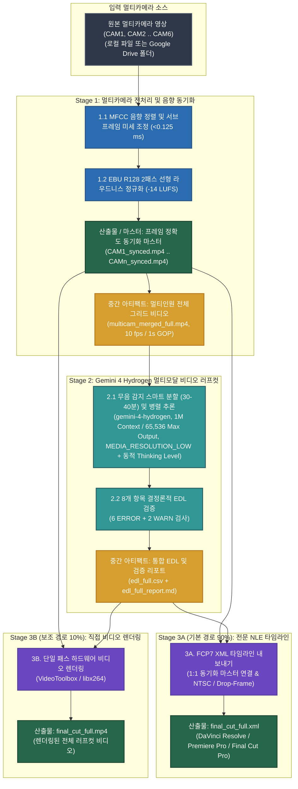

# Multi-Camera Video Pipeline & AI Editing Suite

[](https://github.com/googleapis/python-genai)
[](https://cloud.google.com/vertex-ai)
[](https://ffmpeg.org/)

[English (en)](README.md) | [繁體中文 (zh-TW)](README.zh-TW.md) | [简体中文 (zh-CN)](README.zh-CN.md) | [日本語 (ja)](README.ja.md) | [한국어 (ko)](README.ko.md)

---

> [!IMPORTANT]
> **Google Antigravity 네이티브 플러그인 및 워크플로 스위트**  
> 본 툴킷은 **Google Antigravity**(**Vertex AI Gemini 4 Hydrogen**, `gemini-4-hydrogen` 기반) 및 전문 NLE 소프트웨어(**DaVinci Resolve**, **Adobe Premiere Pro**, **Final Cut Pro**)를 위한 3단계 멀티카메라 전처리 및 AI 러프컷 워크플로를 제공합니다.

---

**Multi-Camera Video Pipeline & AI Editing Suite**는 2~6대 카메라 음향 동기화, 방송 표준 라우드니스 정규화, AI 러프컷 타임라인 생성 및 멀티카메라 프리뷰 비디오 렌더링을 수행합니다. Antigravity 채팅 창에서 자연어로 지시하면 멀티카메라 동기화부터 러프컷 생성까지 전체 워크플로를 자동으로 실행합니다.

---

## 설치 및 Google Cloud 설정 (`setup.sh`)

본 프로젝트는 [Agent Plugins 1.0](https://agent-plugins.org/) 표준을 준수하며 **Google Cloud Vertex AI (ADC)** 및 **Cloud Storage (GCS)** 기반으로 동작합니다.

### 1단계 — Antigravity Plugin 설치

```bash
agy plugin install https://github.com/sylphlin/multicam-video-preprocessing
```

### 2단계 — Python 및 미디어 의존성 설치

`requirements.txt`를 설치합니다. 시스템에 FFmpeg가 없는 경우 `static-ffmpeg`가 크로스 플랫폼 `ffmpeg` 및 `ffprobe` 바이너리를 자동으로 제공하며, 시스템에 네이티브 FFmpeg가 이미 설치된 경우 네이티브 환경과 하드웨어 가속(`h264_videotoolbox`)을 그대로 유지합니다.

```bash
pip install -r ~/.gemini/config/plugins/multicam-video-preprocessing/requirements.txt
```

### 3단계 — ADC 인증 및 Google Cloud 리소스 프로비저닝 (`setup.sh`)

Application Default Credentials를 인증하고 `setup.sh`를 실행하여 GCS 버킷, 2단계 수명 주기 규칙(`raw/`: 2일, 산출물: 15일), IAM 권한 및 `.env`를 설정합니다:

```bash
gcloud auth application-default login
cd ~/.gemini/config/plugins/multicam-video-preprocessing
chmod +x setup.sh
./setup.sh --project YOUR_GCP_PROJECT_ID
```

### 디렉터리 구조 (Agent Plugins 1.0 표준)
```text
multicam-video-preprocessing/
├── plugin.json                                           # Antigravity 플러그인 매니페스트
├── assets/
│   └── logo.svg                                          # 플러그인 벡터 아이콘
├── requirements.txt                                      # Python 및 크로스 플랫폼 static-ffmpeg 의존성 목록
├── rules/
│   └── AGENTS.md                                         # 플러그인 내장 클라이언트 실행 규칙 (<PLUGIN_ROOT> 직접 CLI 호출 및 Fail-Fast)
├── .agents/
│   └── rules/
│       └── DEVELOPMENT.md                                # 워크스페이스 및 개발 표준 (Part I & Part II)
├── skills/
│   └── multicam-video-preprocessing/                     # 표준 스킬 번들 (Single Source of Truth)
│       ├── SKILL.md                                      # 스킬 명세 및 3단계 실행 런북
│       ├── scripts/                                      # 핵심 실행 스크립트 및 모듈 (SSOT)
│       │   ├── multicam_pipeline.py                      # Stage 1: MFCC 동기화, -14 LUFS 정규화, 동기화 마스터, 그리드 합성
│       │   ├── generate_edl.py                           # Stage 2: Vertex AI Gemini 4 Hydrogen EDL 생성 및 무음 스마트 분할
│       │   ├── export_fcp7_xml.py                        # Stage 3A: FCP7 XML 타임라인 내보내기 (기본 경로)
│       │   ├── edl_to_video.py                           # Stage 3B: 단일 패스 하드웨어 비디오 렌더링 (보조 경로)
│       │   └── modules/                                  # 음향, 비디오, 무음 분할, 검증기 및 GCP/Vertex AI 모듈
│       └── assets/                                       # 프롬프트 템플릿 (SSOT)
│           └── edl_interview_template.md                 # Gemini 멀티모달 인터뷰 러프컷 규칙
├── setup.sh                                              # 네이티브 gcloud 설정 스크립트 (GCS, 수명 주기, IAM, .env)
├── .env.example                                          # Vertex AI (ADC) 및 GCS 환경 변수 템플릿
└── tests/                                                # 오프라인 단위 테스트 스위트 (54개 테스트)
```

---

## 3단계 엔드투엔드 워크플로 아키텍처



---

## Antigravity 사용 방법 및 시나리오 (Usage & Scenarios)

Antigravity에서는 다음 두 가지 방식으로 실행합니다:
1. **간결한 명령어 (`/skill` + `@파일`)**: `/multicam-video-preprocessing`을 선택하고 `@`로 카메라 영상 파일이나 Google Drive 폴더 링크를 지정합니다.
2. **자연어 프롬프트**: 동기화 및 편집 요청 사항을 자연어로 입력하고 `@` 파일이나 클라우드 링크를 첨부합니다.

### 시나리오 1: 전문 NLE용 FCP7 XML 타임라인 내보내기 (권장 기본 워크플로)
- **사용 사례**: AI 러프컷 카메라 전환 결정을 DaVinci Resolve, Adobe Premiere Pro 또는 Final Cut Pro로 가져와 정밀 편집 및 색보정을 수행합니다.
- **방식 A (`/ + @` 간결한 명령어)**:
  ```text
  /multicam-video-preprocessing 카메라1: @CAM1.mp4, 카메라2: @CAM2.mp4
  ```
- **방식 B (자연어 프롬프트)**:
  ```text
  @CAM1.mp4와 @CAM2.mp4를 동기화하고 라우드니스를 -14 LUFS로 정규화한 뒤, DaVinci Resolve용 FCP7 XML 러프컷 타임라인을 내보내 줘.
  ```
- **산출물**:
  1. `final_cut_full.xml` (카메라 전환 지점 및 편집 사유 마커가 포함된 타임라인).
  2. `CAM1_synced.mp4`, `CAM2_synced.mp4` (시간 정렬 및 `-14 LUFS` 정규화가 완료된 카메라 마스터).
- **DaVinci Resolve 가져오기 절차**:
  1. DaVinci Resolve를 열고 새 프로젝트를 생성합니다.
  2. `output/CAM1_synced.mp4` 및 `output/CAM2_synced.mp4`를 **Media Pool**로 드래그합니다.
  3. **File -> Import -> Timeline...** (`Cmd + Shift + I`)을 선택하고 `final_cut_full.xml`을 가져옵니다.

### 시나리오 2: 멀티카메라 러프컷 비디오 직접 렌더링
- **사용 사례**: NLE 소프트웨어를 열지 않고 카메라 전환이 완료된 MP4 러프컷 비디오를 직접 렌더링합니다.
- **방식 A (`/ + @` 간결한 명령어)**:
  ```text
  /multicam-video-preprocessing 카메라1: @CAM1.mp4, 카메라2: @CAM2.mp4, 출력: MP4 직접 렌더링
  ```
- **방식 B (자연어 프롬프트)**:
  ```text
  @CAM1.mp4와 @CAM2.mp4를 멀티카메라 AI 러프컷하고 final_cut_full.mp4로 직접 렌더링해 줘.
  ```
- **산출물**:
  1. `final_cut_full.mp4` (단일 패스 하드웨어 가속으로 렌더링된 전체 비디오).
  2. `edl_full.csv` 및 `edl_full_report.md` (카메라 전환 결정표 및 8개 항목 검증 리포트).

### 시나리오 3: Google Drive 폴더에서 멀티카메라 동기화 및 러프컷 수행
- **사용 사례**: 공유 Google Drive 폴더 내 모든 카메라 영상을 `md5Checksum` 캐시 검증과 함께 처리하고 타임라인을 생성합니다.
- **방식 A (`/ + @` 간결한 명령어)**:
  ```text
  /multicam-video-preprocessing 폴더: https://drive.google.com/drive/folders/FOLDER_ID
  ```
- **방식 B (자연어 프롬프트)**:
  ```text
  Google Drive 폴더 https://drive.google.com/drive/folders/FOLDER_ID 의 멀티카메라 영상을 다운로드하여 오디오 동기화 및 -14 LUFS 정규화를 수행하고 FCP7 XML 타임라인을 생성해 줘.
  ```
- **산출물**:
  1. `CAM1_synced.mp4` .. `CAMn_synced.mp4` (동기화 및 라우드니스 정규화 마스터).
  2. `edl_full.csv`, `edl_full_report.md`, `final_cut_full.xml`.

---

## 3단계 핵심 기술 개요

### Stage 1: 멀티카메라 동기화 및 전처리
1. **MFCC 음향 정렬 및 서브프레임 미세 조정 (`<0.125 ms`)**: 3단계 폴백 스캔(120초 고속 스캔 $\rightarrow$ 전체 MFCC $\rightarrow$ 원시 파형 1D FFT)을 수행하여 `8 kHz` 단일 오디오 샘플 정밀도로 정렬하고 FFT 메모리 사용량을 `97.7%` 절감합니다.
2. **EBU R128 (`-14 LUFS`) 2패스 선형 라우드니스 정규화**: 1패스에서 `I`, `LRA = 11.0 LU`, `TP = -1.5 dBTP`를 측정하고, 2패스에서 선형 게인(`linear=true`)을 적용합니다.
3. **프레임 정확도 동기화 마스터 출력 (`CAM*_synced.mp4`)**: 하드웨어 가속(`h264_videotoolbox` 또는 `libx264`, `20 Mbps`)으로 재인코딩하여 키프레임 드리프트를 방지합니다.
4. **전체 경량 그리드 합성 (`multicam_merged_full.mp4`)**: 2~6대 동기화 카메라를 단일 라벨 캔버스($\le 1920 \times 1080$, 셀당 $\ge 640 \times 480$)로 `10 fps`, `1.2 Mbps`, 1초 GOP 조건으로 합성합니다.

### Stage 2: Gemini 4 Hydrogen 멀티모달 러프컷 및 무음 감지 스마트 분할
1. **프리롤 및 카운트다운 제거**: 슬레이트, 마이크 테스트 및 카운트다운(`5, 4, 3, 2, 1`)을 제거하고 `[Global_Start_Time, Global_Start_Time + 2.0s]` 구간을 검증하며 `Global_End_Time` 이후 잡담을 트리밍합니다.
2. **Gemini 4 Hydrogen 표준 멀티모달 추론**:
   - 기본 모델 `gemini-4-hydrogen`(**Vertex AI Gemini 4 Hydrogen**)을 사용하며, 통합 `1M` 토큰 컨텍스트 윈도우와 사고 및 출력 토큰 통합 `65,536` `max_output_tokens` 상한을 적용합니다.
   - 표준 멀티모달 모드(`MEDIA_RESOLUTION_LOW`)를 실행하고 `resolve_thinking_level`을 통해 영상 길이에 따라 동적 `thinking_level`(`low` / `medium` / `high`)을 매핑하며, Gemini 4 호환성을 위해 `temperature`를 생략합니다.
3. **무음 감지 스마트 분할 (`30–40분` 윈도우)**:
   - 40분(`2400s`) 이하 영상은 단일 패스로 처리합니다.
   - 40분을 초과하는 영상은 `generate_edl.py`가 `ffmpeg silencedetect` 및 RMS 에너지 최솟값으로 자연 발화 휴지점을 감지하여 `<output_dir>/_edl_chunks/`에 무손실 분할합니다.
   - `gs://<bucket>/raw/edl_chunks/`를 통해 병렬 Vertex AI 추론을 실행하고 타임스탬프를 시프트하여 `edl_full.csv`로 병합한 뒤, `finally` 블록에서 로컬 및 GCS 임시 청크를 삭제합니다.
4. **8개 항목 결정론적 EDL 의미 검증**: `E_NO_ROWS`, `E_PARSE_TIME`, `E_NEGATIVE_DURATION`, `E_NON_MONOTONIC`, `E_OVERLAP`, `E_EMPTY_CAMERA`, `W_UNKNOWN_CAMERA`, `W_GAP`을 검증하고 `edl_full.csv` 및 `edl_full_report.md`를 생성합니다.

### Stage 3A & 3B: FCP7 XML 타임라인 내보내기 및 하드웨어 비디오 렌더링
- **Stage 3A (기본 경로)**: 동기화 마스터를 1:1 타임코드(`start == in`, `end == out`)로 연결하며, NTSC 소수점 프레임 레이트(`23.976`, `29.97`, `59.94`) 및 드롭 프레임(Drop-Frame)을 지원하는 `final_cut_full.xml`을 내보냅니다.
- **Stage 3B (보조 경로)**: 요청 시 동기화 마스터에서 단일 패스 하드웨어 가속 렌더링을 수행하여 `final_cut_full.mp4`를 출력합니다.

---

## GCS 2단계 수명 주기 정책 (`gs://multicam-video-${PROJECT_ID}`)

| GCS 경로 접두사 (`matchesPrefix`) | 저장 객체 | 보관 기간 (`age`) | 정리 방식 |
| :--- | :--- | :--- | :--- |
| **`raw/`** | 스테이징된 그리드 비디오 (`multicam_merged_full.mp4`) 및 임시 청크 (`raw/edl_chunks/*`) | **2일 (`age: 2`)** | `raw/edl_chunks/*`는 추론 직후 `finally` 블록에서 즉시 삭제되며, 전체 그리드 비디오는 SHA-256 캐시 재사용을 위해 2일간 보관 후 자동 삭제합니다. |
| **`output/`**, **`deliverables/`**, **`multicam_assets/`** | XML/CSV 타임라인, 렌더링 비디오 및 검증 리포트 | **15일 (`age: 15`)** | 팀 검토를 위해 15일간 보관한 후 자동 삭제합니다. |

---

## 라이선스 (License)

이 프로젝트는 [MIT License](LICENSE)를 따릅니다.
