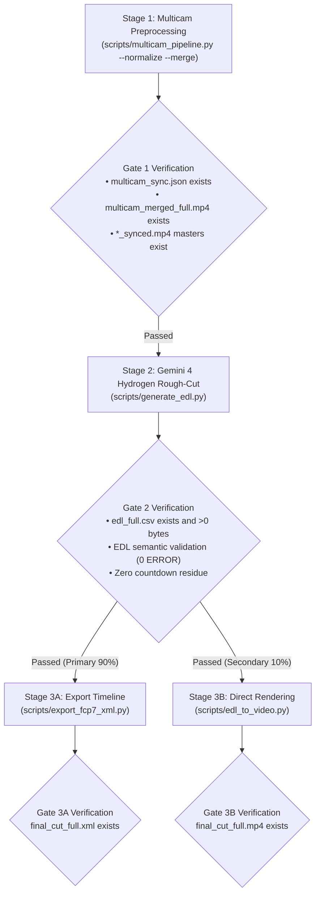

# Multi-Camera Video Pipeline & AI Editing Suite (Antigravity Native Skill)

This skill synchronizes 2 to 6 camera angles, generates AI rough-cut decisions with **Vertex AI Gemini 4 Hydrogen** (`gemini-4-hydrogen`, unified `1M` token context window), and exports timelines for DaVinci Resolve, Adobe Premiere Pro, and Final Cut Pro.

---

## Prerequisites & Environment

- **Google Antigravity IDE / Agent Framework**
- **Python 3.8+ & Media Dependencies (`requirements.txt`)**:
  - Run `pip install -r requirements.txt` (`numpy`, `google-genai`, `google-cloud-storage`, `google-auth`, `requests`, `static-ffmpeg`).
  - `static-ffmpeg` supplies cross-platform `ffmpeg` and `ffprobe` binaries (with `loudnorm` filter support) when system FFmpeg is absent. When native FFmpeg is installed, the pipeline preserves system FFmpeg and `h264_videotoolbox` hardware encoding.
- **Cloud Credentials (100% ADC + Vertex AI & GCS)**:
  - Run `gcloud auth application-default login` to authenticate Application Default Credentials.
  - Run `./setup.sh --project YOUR_GCP_PROJECT_ID` once. This script provisions the GCS bucket (`gs://multicam-video-${GOOGLE_CLOUD_PROJECT}`), configures two-tier lifecycle rules (`raw/` staging: 2 days; `output/`, `deliverables/`, `multicam_assets/` deliverables: 15 days), binds Vertex AI Service Agent IAM (`roles/storage.objectUser`), and writes `.env`.

---

## Modular Toolset Architecture

| Step | Script | Core Module (`scripts/modules/`) | Function |
| :--- | :--- | :--- | :--- |
| **Step 1** | `scripts/multicam_pipeline.py` | `audio_sync.py`, `audio_normalizer.py`, `video_composer.py` | MFCC Acoustic Sync + Subframe Refinement (`<0.125ms`), EBU R128 (`-14 LUFS`), Synced Masters, Multi-in-One Full Grid (`multicam_merged_full.mp4`) |
| **Step 2** | `scripts/generate_edl.py` | `llm_client.py`, `gcp_client.py`, `video_segmenter.py`, `progress.py`, `edl_validator.py`, `assets/edl_interview_template.md` | Vertex AI Gemini 4 Hydrogen (`gemini-4-hydrogen`, `1M` context, `65,536` `max_output_tokens`, `MEDIA_RESOLUTION_LOW`, dynamic `thinking_level`) + Silence-Aware 30-40m Segmentation + EDL Validation -> `edl_full.csv` + Report |
| **Step 3A** | `scripts/export_fcp7_xml.py` | `reporter.py`, `time_utils.py`, `edl_validator.py` | Full-length EDL CSV -> FCP7 XML (`final_cut_full.xml`) for DaVinci / Premiere (EDL validation, NTSC float fps & drop-frame support) |
| **Step 3B** | `scripts/edl_to_video.py` | `video_composer.py`, `edl_validator.py` | Hardware-accelerated clip cutting directly from synced masters -> `final_cut_full.mp4` (with EDL validation) |

---

## Core Technical Principles

1. **MFCC Acoustic Time Alignment & Subframe Refinement (`<0.125ms` Accuracy)**:
   - `audio_sync.py` aligns camera tracks using pure `numpy` MFCC cross-correlation with a 3-tier fallback ladder (Fast 120s scan -> Full-length MFCC -> Raw waveform 1D FFT).
   - Time-domain subframe refinement locks alignment within `<0.125ms` (one audio sample at `8 kHz`) and reduces FFT memory usage by `97.7%`.
   - The pipeline evaluates BBC confidence thresholds ($Z \ge 12.0$ High `Aligned`, $7.0 \le Z < 12.0$ Medium `Aligned (marginal)`, $Z < 7.0$ Low `LOW CONFIDENCE`). Pass `--strict-sync` to exit non-zero on low confidence.
   - `multicam_pipeline.py` re-encodes synchronized masters (`CAM*_synced.mp4`) with hardware acceleration (`h264_videotoolbox` or `libx264 -crf 18`) to prevent keyframe drift.
2. **EBU R128 Two-Pass Linear Loudness Normalization**:
   - `audio_normalizer.py` normalizes audio tracks to `-14.0 LUFS` (`LRA = 11.0 LU`, `TP = -1.5 dBTP`) for broadcast consistency.
   - Pass 1 measures integrated loudness and true peak. Pass 2 applies linear gain (`linear=true`) to prevent dynamic pumping.
3. **Gemini 4 Hydrogen Multimodal Inference & Silence-Aware Smart Segmentation**:
   - `generate_edl.py` and `llm_client.py` default to `gemini-4-hydrogen` (**Vertex AI Gemini 4 Hydrogen**), which provides a unified `1M` token context window and enforces a `65,536` `max_output_tokens` cap across thinking and output tokens.
   - Standard Multimodal mode (`MEDIA_RESOLUTION_LOW`) runs by default (`--processing standard`). It maps video duration to a dynamic `thinking_level` (`low`, `medium`, or `high`) via `resolve_thinking_level` (`<= 2,048` -> `low`, `<= 4,096` -> `medium`, `> 4,096` -> `high`) and omits `temperature` for Gemini 4 compatibility.
   - Videos up to 40 minutes (`2400s`) run in a single pass. For videos longer than 40 minutes, `generate_edl.py` detects natural speech pauses in 30-to-40-minute windows (`silencedetect` + RMS energy minimum), slices temporary chunks into `<output_dir>/_edl_chunks/`, runs parallel Vertex AI inference via `gs://<bucket>/raw/edl_chunks/`, stitches shifted timestamps into `edl_full.csv`, and deletes all temporary local and GCS chunks in `finally` blocks.
4. **Token- & Seek-Optimized Compact Grid Composition**:
   - `video_composer.py` merges 2 to 6 cameras into one labeled canvas ($\le 1920 \times 1080$, each cell $\ge 640 \times 480$) at `1200k` video bitrate, `10 fps`, 1-second GOP (`-g 10`), `16 kHz` mono audio (`64k`), and `-movflags +faststart`.
5. **Pre-Roll & Countdown Removal (Zero-Tolerance & Asymmetric Safety Margin)**:
   - The EDL prompt removes clapperboards, mic checks, and on-set countdowns (`5, 4, 3, 2, 1`, `Ready Action`).
   - It verifies `[Global_Start_Time, Global_Start_Time + 2.0s]` to align the opening cut with the speaker's first true word and trims post-interview chatter at `Global_End_Time`.
6. **100% Pure Vertex AI (ADC) & GCS Cloud Architecture (Zero AI Studio Keys)**:
   - All model calls run on **Google Cloud Vertex AI** (`GOOGLE_CLOUD_LOCATION=global`) via Application Default Credentials (`gcloud auth application-default login`).
   - `gcp_client.py` stages media to **Google Cloud Storage** (`gs://multicam-video-${PROJECT_ID}/raw/`) with SHA-256 hash caching, a 2-day GCS Bucket Lifecycle auto-deletion policy, and optional `--cleanup-gcs` immediate deletion.
7. **Deterministic EDL Semantic Validation & `--strict-edl` Safeguard**:
   - `edl_validator.py` runs 8 structural checks before disk write in `generate_edl.py` and upon EDL load in `export_fcp7_xml.py` and `edl_to_video.py`.
   - It checks 6 ERROR codes (`E_NO_ROWS`, `E_PARSE_TIME`, `E_NEGATIVE_DURATION`, `E_NON_MONOTONIC`, `E_OVERLAP`, `E_EMPTY_CAMERA`) and 2 WARN codes (`W_UNKNOWN_CAMERA`, `W_GAP`).
   - Pass `--strict-edl` to exit with code `1` on any ERROR (`generate_edl.py` writes outputs to disk before exiting for inspection). Pass `--lang` (`en` or `zh-TW`), `--edl-max-gap-sec` (default `0.05`), and `--edl-known-cameras` (default `^CAM\d+$`) to customize validation.

---

## 3-Stage Gated Execution Runbook

Execute this sequential 3-stage gated workflow for multi-camera tasks. Resolve `${SKILL_DIR}` to the directory containing this `SKILL.md` (`skills/multicam-video-preprocessing`).



### Live Progress Reporting & User Feedback Protocol
- **Before Each Stage**: Send a concise status update announcing the active stage and its sub-steps (`Stage 1: Step 1/4 Audio Sync -> Step 2/4 -14 LUFS Norm -> Step 3/4 Synced Masters -> Step 4/4 Grid Merge`, `Stage 2: Step 1/3 Silence Segmentation -> Step 2/3 Gemini 4 Hydrogen Inference -> Step 3/3 8-Check EDL Validation`, `Stage 3A: FCP7 XML Export`, `Stage 3B: Direct Video Render`).
- **During Long-Running Commands (`NotificationTimeoutSeconds=60`)**:
  - Pass `NotificationTimeoutSeconds=60` when running `multicam_pipeline.py`, `generate_edl.py`, or `edl_to_video.py` via `run_command`.
  - When a command is still running after 60 seconds, inspect the latest `[Stage N - Step X/Y]` and `[In Progress]` lines in the task output, report the active step and elapsed time to the user, and schedule a 60-second follow-up check (`schedule` with `DurationSeconds="60"` and `TimerCondition="<task-id>"`).

### Stage 1: Physical Preprocessing (Sync, Normalization, Master Export, Grid Merge)
- **User Status Update**: `"正在執行 Stage 1：多機位聲學對齊、-14 LUFS 響度標準化、同步母帶匯出與多分割網格合成..."` (localized to user's language)
- **Execution Command** (run with `NotificationTimeoutSeconds=60`):
  ```bash
  # Local Camera Files or Google Drive File Links:
  python3 "${SKILL_DIR}/scripts/multicam_pipeline.py" \
    --ref <CAM1.mp4_OR_GDRIVE_LINK> --targets <CAM2.mp4_OR_GDRIVE_LINK...> \
    --normalize --merge -o <OUTPUT_DIR>

  # Or Direct Google Drive Folder URL / Folder ID (Auto-discovers & sorts CAM1..CAMn via ADC):
  python3 "${SKILL_DIR}/scripts/multicam_pipeline.py" \
    --gdrive-folder "<GDRIVE_FOLDER_URL_OR_ID>" \
    --normalize --merge -o <OUTPUT_DIR>
  ```
- **Exit Gate 1 Verification (Mandatory before Stage 2)**:
  - `<OUTPUT_DIR>/multicam_sync.json` exists with valid offset data.
  - `<OUTPUT_DIR>/<CAM>_synced.mp4` full-length synchronized masters exist for all cameras.
  - `<OUTPUT_DIR>/multicam_merged_full.mp4` grid video exists and is non-empty.

### Stage 2: Gemini 4 Hydrogen Multimodal Rough-Cut (Silence-Aware Smart Segmentation + Parallel Low-Res Inference)
- **User Status Update**: `"正在執行 Stage 2：靜音感知智慧分段與 Gemini 4 Hydrogen 多模態鏡頭粗剪分析..."` (localized to user's language)
- **Model Defaults**: Uses `--model gemini-4-hydrogen` (`1M` token context window, `65,536` `max_output_tokens` cap across thinking and output tokens) in `--processing standard` (`MEDIA_RESOLUTION_LOW`) with dynamic `thinking_level` (`low` / `medium` / `high` via `resolve_thinking_level`) and `temperature` omitted.
- **Execution Command** (run with `NotificationTimeoutSeconds=60`):
  ```bash
  python3 "${SKILL_DIR}/scripts/generate_edl.py" \
    -v <OUTPUT_DIR>/multicam_merged_full.mp4 \
    --strict-edl --lang <zh-TW|en>
  ```
- **Exit Gate 2 Verification (Mandatory before Stage 3)**:
  - `<OUTPUT_DIR>/edl_full.csv` exists and size $> 0\text{ bytes}$.
  - Deterministic EDL semantic validation passed with zero `ERROR` issues (`E_NO_ROWS`, `E_PARSE_TIME`, `E_NEGATIVE_DURATION`, `E_NON_MONOTONIC`, `E_OVERLAP`, `E_EMPTY_CAMERA`).
  - `<OUTPUT_DIR>/edl_full_report.md` exists with cutting rationale and validation report table.

### Stage 3A: Export NLE Timeline (Primary Path / 90% Use Case)
- **User Status Update**: `"正在執行 Stage 3A：匯出剪輯時間線 (FCP7 XML)..."` (localized to user's language)
- **Execution Command**:
  ```bash
  python3 "${SKILL_DIR}/scripts/export_fcp7_xml.py" \
    -d <OUTPUT_DIR> -o <OUTPUT_DIR>/final_cut_full.xml \
    --strict-edl --lang <zh-TW|en>
  ```
- **Exit Gate 3A Verification & Proactive Stage 3B Offer**:
  - Verify `<OUTPUT_DIR>/final_cut_full.xml` exists and size $> 0\text{ bytes}$.
  - **Mandatory User Prompt**: When finishing at Stage 3A (without running Stage 3B), explicitly inform the user that you can also run **Stage 3B (`edl_to_video.py`)** to render a playable multi-camera rough-cut MP4 (`<OUTPUT_DIR>/final_cut_full.mp4`) from `edl_full.csv`.

### Stage 3B: Direct Video Rendering (Secondary Fast Preview Path / 10% Use Case)
- **User Status Update**: `"正在執行 Stage 3B：依照 EDL 切換機位渲染成品影片 (final_cut_full.mp4)..."` (localized to user's language)
- **Execution Command** (run with `NotificationTimeoutSeconds=60`):
  ```bash
  python3 "${SKILL_DIR}/scripts/edl_to_video.py" \
    --edl <OUTPUT_DIR>/edl_full.csv --media-dir <OUTPUT_DIR> \
    -o <OUTPUT_DIR>/final_cut_full.mp4 --strict-edl --lang <zh-TW|en>
  ```
- **Exit Gate 3B Verification**:
  - `<OUTPUT_DIR>/final_cut_full.mp4` exists with duration $> 0$.

---

## CLI Options Reference

### 1. Stage 1 — `multicam_pipeline.py`
| Option | Default | Description |
| :--- | :--- | :--- |
| `--ref` | `None` | Reference anchor camera video path or Google Drive link (`CAM1`) |
| `--targets`, `--target` | `None` | Target camera video paths or Google Drive links (`CAM2..CAM6`) |
| `--gdrive-folder` | `None` | Google Drive Folder URL or ID containing 2–6 camera videos |
| `-o`, `--output-dir` | `output` | Output directory for synced camera masters, grid video, and reports |
| `--normalize` | `False` | Enable EBU R128 (`-14.0 LUFS`) two-pass linear audio normalization |
| `--merge`, `--multi-in-one` | `False` | Render merged multi-in-one grid video (`multicam_merged_full.mp4`) |
| `--lufs` / `--lra` / `--tp` | `-14.0` / `11.0` / `-1.5` | EBU R128 integrated loudness, loudness range, and true peak targets |
| `--encoder` | `h264_videotoolbox` | Hardware video encoder (fallback: `libx264`) |
| `--stream-copy` | `False` | Export synced masters using `-c copy` instead of frame-accurate re-encoding |
| `--strict-sync` | `False` | Exit non-zero if any camera alignment confidence score is low (`Z < 7.0`) |

### 2. Stage 2 — `generate_edl.py`
| Option | Default | Description |
| :--- | :--- | :--- |
| `-v`, `--video`, `-i`, `--input` | *(Required)* | Path to composite grid video (`multicam_merged_full.mp4`) |
| `-o`, `--output-dir` | `<video_dir>` | Output directory for `edl_full.csv` and `edl_full_report.md` |
| `-t`, `--template` | `assets/edl_interview_template.md` | Custom prompt template file path |
| `--model` | `gemini-4-hydrogen` | Vertex AI Gemini model ID (unified `1M` token context window) |
| `--processing` | `standard` | Video mode: `standard` (`MEDIA_RESOLUTION_LOW` + silence segmentation) or `agentic` |
| `--max-output-tokens` | `65536` | Max token cap (`65,536`) shared across thinking and output tokens |
| `--thinking-budget` | `Auto` | Duration-scaled token budget mapped via `resolve_thinking_level` to `low`/`medium`/`high` (`temperature` omitted on Gemini 4) |
| `--chunk-min-dur` / `--chunk-max-dur` | `1800.0` / `2400.0` | Min/Max chapter duration in seconds (`30–40 min`) for silence splitting |
| `--timeout` | `600` | HTTP timeout in seconds for Vertex AI video inference |
| `--strict-edl` | `False` | Exit with code `1` when EDL validation finds `ERROR` issues |
| `--lang` | `en` | Language for the EDL validation report (`en`, `zh-TW`) |
| `--edl-max-gap-sec` | `0.05` | Maximum allowed gap in seconds between consecutive EDL cuts |
| `--edl-known-cameras` | `^CAM\d+$` | Comma-separated expected camera names (`CAM1,CAM2,...`) |
| `--cleanup-gcs` | `False` | Immediately delete staged grid video from GCS after completion |

### 3. Stage 3A — `export_fcp7_xml.py`
| Option | Default | Description |
| :--- | :--- | :--- |
| `-d`, `--dir` | `None` | Directory containing `edl_full.csv` and synced camera masters |
| `-e`, `--edl` | `None` | Explicit path(s) to EDL CSV file(s) |
| `-o`, `--output` | `final_cut_full.xml` | Output FCP7 XML timeline path |
| `-m`, `--media-dir` | `<edl_dir>` | Directory containing camera media files |
| `--fps` | `30.0` | Sequence frame rate (`23.976`, `24`, `25`, `29.97`, `30`, `50`, `59.94`, `60`) |
| `--drop-frame` | `False` | Enable drop-frame timecode (`DF`) for NTSC sequences |
| `--use-raw-media` | `False` | Link to original raw camera files using `multicam_sync.json` offsets |
| `--strict-edl` / `--lang` | `False` / `en` | Enforce strict EDL validation and set report language |

### 4. Stage 3B — `edl_to_video.py`
| Option | Default | Description |
| :--- | :--- | :--- |
| `--edl` | *(Required)* | Path to input EDL CSV file (`edl_full.csv`) |
| `--media-dir` | `<edl_dir>` | Directory containing synchronized camera masters (`CAM*_synced.mp4`) |
| `-o`, `--output` | `final_cut_full.mp4` | Output rendered MP4 path |
| `--encoder` | `h264_videotoolbox` | Hardware video encoder for single-pass rendering |
| `--strict-edl` / `--lang` | `False` / `en` | Enforce strict EDL validation and set report language |

